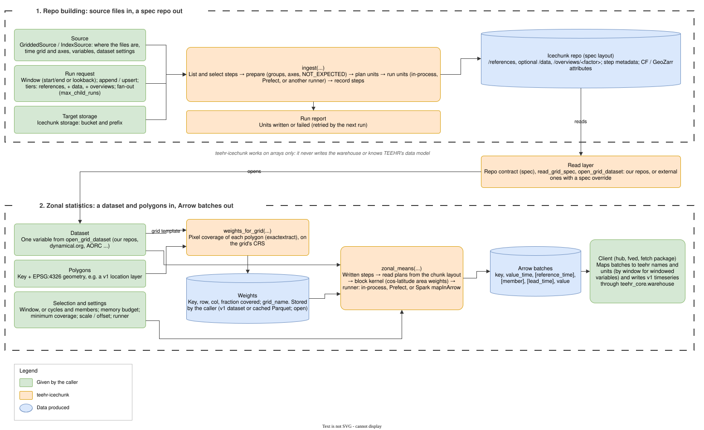
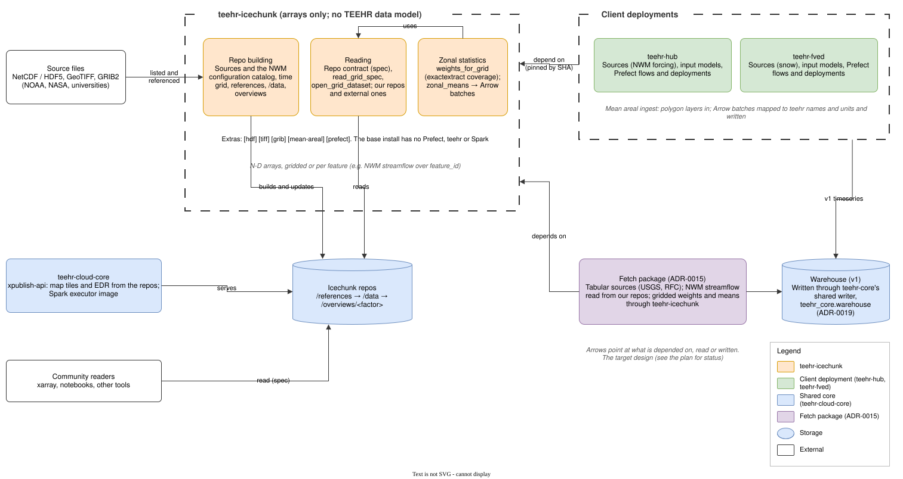
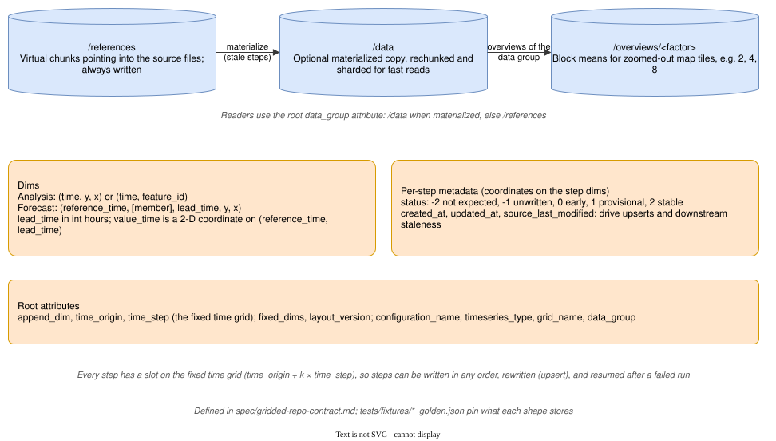
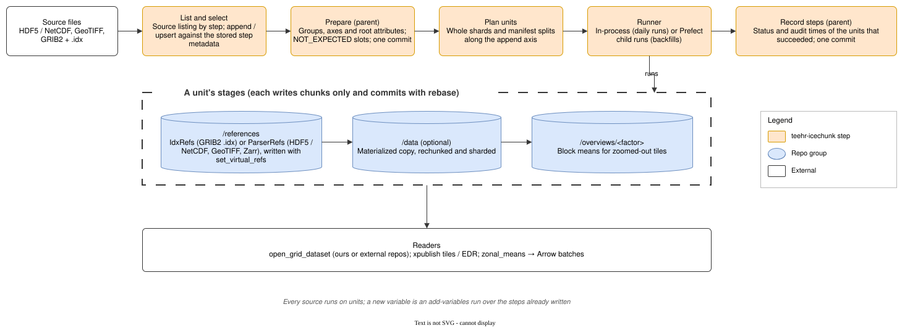
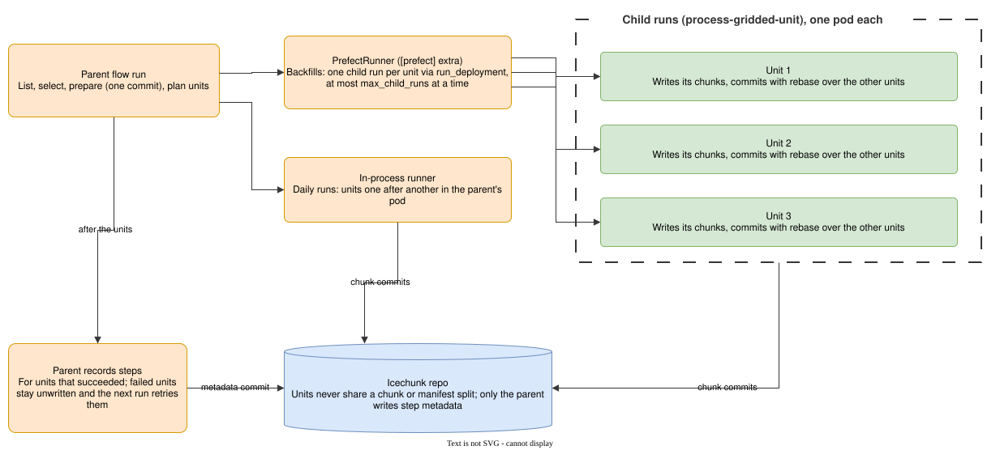

# teehr-icechunk diagrams

Schematic diagrams, generated by Python into one editable draw.io file with one page (tab) per diagram. The approach and helpers follow teehr-cloud-core's `docs/diagrams/drawio/`.

The pages show the **target design**, not only what's implemented today; the plan tracks status.

## Files

| File | Purpose |
|---|---|
| `teehr-icechunk.drawio` | The diagrams, one per page. Open it in the draw.io desktop app, at [app.diagrams.net](https://app.diagrams.net), or with the VS Code *Draw.io Integration* extension. |
| `build_diagrams.py` | One function per page, plus the `PAGES` list that sets which pages are built and in what order. |
| `drawio_helpers.py` | Shared styles and colors, the `Page` class, and `write_drawio()` (copied from teehr-cloud-core). |
| `svg/` | SVG exports of each page, for viewing on GitHub. |

## Pages

1. **Two paths: inputs and outputs.** Repo building (a source, a run request and target storage in; a spec repo and a run report out) and zonal statistics (a dataset, polygons and a selection in; weights and Arrow batches out, which clients map and write to the warehouse), joined by the read layer.
2. **Package boundaries.** What teehr-icechunk holds (repo building, reading, zonal statistics) and what it doesn't: the client deployments, teehr-cloud-core, the planned fetch package and the warehouse, with arrows pointing at what each depends on or reads.
3. **Repo layout.** The groups (`/references` → `/data` → `/overviews/<factor>`), dims, per-step metadata and root attributes that `spec/gridded-repo-contract.md` defines.
4. **Gridded workflow.** List and select, prepare, plan segments, run them (in-process or as child runs), record steps; a segment's stages; the readers.
5. **Run model and fan-out.** The parent, the in-process and Prefect runners, child runs committing chunks with rebase, and the parent's metadata commit.

### Previews











## Running the script

The script needs only the Python 3 standard library.

```bash
cd docs/diagrams/drawio
python3 build_diagrams.py
```

> **Rebuilding overwrites the .drawio file**, including any edits made by hand in draw.io. Keep the script as the source of truth, or switch to editing in draw.io once a layout is final.

## Exporting SVGs

GitHub doesn't render `.drawio` files, so each page is also exported to `svg/`. Re-export whenever the diagrams change:

```bash
cd docs/diagrams/drawio
rm -rf svg
docker run --rm -u "$(id -u):$(id -g)" -e HOME=/tmp -v "$PWD":/data -w /data \
  rlespinasse/drawio-export:v4.60.0 \
  -f svg -o svg -b 10 --svg-theme light --embed-svg-fonts false teehr-icechunk.drawio
```
